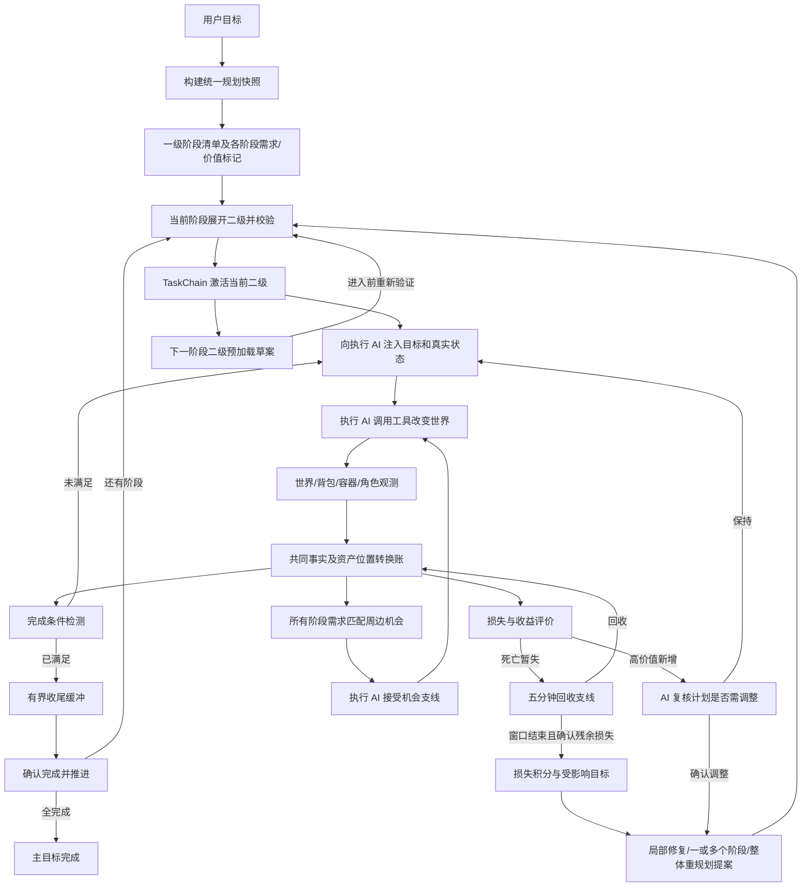

# 任务链最终架构、使用说明与 AI 施工说明

版本：v0.10，2026-10-07（补正式支线与周期任务）。依据：用户本次最终架构口述，以及本会话已读源码。性质：**最终架构方向已明确；数值口径与少数语音歧义待确认。本文交付的是设计，不代表功能已实现或通过实机验收。**

本文为独立无编号架构文档，不占统一版 NN 编号。承接《第三批预备构想-环境事实与任务链增强-20261004.md》；本次口述明确补充了资产转换、积分档位、死亡回收窗口、机会采集、收尾缓冲及预加载。早期备忘与本次冲突处，以本次明确要求为准。

## 1. 最终目标与边界

让任务链知道：正在完成什么、每个阶段需要什么、这些东西有多重要、东西实际在哪里、丢失是否真实且不可回收、周边是否存在值得顺手利用的机会，以及何时只补救、何时改一个阶段、何时重做总体规划。

保留现有 Goal → PrimaryGoal → Subtask 两级目标体系，TaskChain 继续唯一拥有主链进度。RDD 负责规划、判定和任务协调，执行 AI 负责选择与调用身体工具。共同世界事实提供观测；积分提供决策依据；两者均不直接改写主链。

用户已经明确的要求：

| ID | 要求 | 本文安排 |
|---|---|---|
| TC-R01 | 生成目标时为所需物资标注 50/20/10/5/1/0 分 | P0 |
| TC-R02 | 高价值损失触发分级规划；50/100 为口述阈值例子 | P0；准确边界待确认 |
| TC-R03 | 世界资产包含坐标、基地、重要地标、箱子及内容 | P0 最小语义；P1 扩展 |
| TC-R04 | 背包转箱子、放置等是资产转换，不能直接算丢失 | P0 |
| TC-R05 | 死亡先走回收支线；五分钟回收窗口内不因这批掉落升级重规划 | P0 |
| TC-R06 | 确认损失后，AI 判断改一个/两个一级目标或整体计划 | P0 |
| TC-R07 | 每个一级阶段提前生成需求物资及分值 | P0 数据契约；P1 机会消费 |
| TC-R08 | 周边检测未来需求（如钻石、钻石块），提醒执行 AI 提前取用 | P1 |
| TC-R09 | 提前获得只记资产，默认不改原主链；收益很高再请 AI 确认 | P1 |
| TC-R10 | 低价值任务可以跳过 | P1，受必需性约束 |
| TC-R11 | 达标后有缓冲期，可多采一点、捡完掉落、检查邻近贵重资源 | P1 |
| TC-R12 | 预生成下一一级的二级目标，以减少切换等待 | P1 |
| TC-R13 | 每次规划注入世界、资产、背包、角色状态及语义资产 | P0 |
| TC-R14 | 清理低价值资产垃圾，注入核心信息 | P0 投影；P1 生命周期清理 |
| TC-R15 | 未来经验只给目录，由 AI 按需打开，与携带器联动 | P2 |
| TC-R16 | 好奇心、自主探索、自生任务 | P3 |
| TC-R17 | 扩展已有世界状态感知，拓宽可规划和可判定任务 | P2/P3 |
| TC-R18 | 把睡觉闹钟从提醒升级为正式硬编码支线，临时覆盖执行目标，监督同步切换 | 近期优先，P0-07 |
| TC-R19 | 夜晚到来前约一分钟启动睡觉支线，完成或超时跳过后回主线 | 近期优先，P1-05 |
| TC-R20 | 预留每两三游戏日收割/补种等周期任务，死亡支线后续再迁入统一体系 | 本期预留契约；迁移另行安排 |

口述“删除物品、方块、壁纸”“事业红”有识别歧义：暂理解前者为物品/方块等世界资产的语义记录与位置追踪，后者为已有视野/世界感知模块。**不据此新增自动拆除方块、删除实体或物理丢弃物品的权限。**

## 2. 主线路与分支



横贯所有分支：owner 暂停、世界/目标/计划代次校验、预算与去重、持久化恢复、可观察事件。紧急避险优先于收尾和机会支线。图中预加载时机为建议，见第 9 节。

新增正式支线后，上图执行与监督入口统一经过第 15 节的 ActiveTask 仲裁。主线 TaskChain 仍拥有主线进度，但并非任何时刻都是当前执行目标；睡觉支线激活期间，由支线拥有当前执行/监督目标。

## 3. 当前代码基线及证据边界

源码根目录：`E:\restart developing doer\minecraft-numen\`。下表行号为本会话读取时锚点，施工前须重新搜索方法名。

| 文件与锚点 | 已核实行为 | 本次目标差距 |
|---|---|---|
| `rdd-core/src/main/java/com/dwinovo/numen/rdd/core/TaskChain.java:19` | 保存 goal、状态、指针、acquire 基线、计划代次、完成阶段事实 | 未见统一积分与资产位置转换账 |
| 同文件 `:292 / :344 / :426 / :447` | 快照激活、带基线启动、硬判完成、监督决定 | 新策略仍须经过这些状态所有者入口 |
| 同文件 `:555 / :787 / :821` | 当前一级换二级计划；JSON 保存与恢复 | 当前接口不等于支持任意多个一级/全链安全改写 |
| `rdd-core/.../core/HardCodedEvaluator.java:56` | hold 持有量；acquire 当前量减基线；缺基线判 false | 积分不能替代完成条件；group 分支先返回，未统一处理 mode |
| `rdd-core/.../core/PlanningAssetSnapshot.java:50` | 背包实时扫描决定 available，注册表仅供 lost/unknown 提示 | 箱内资产须新增“拥有/可访问/随身”区分，不能直接合进 held |
| `plugins/rdd/src/main/java/com/dwinovo/numen/plugins/rdd/RddPlugin.java:335` | Stage-A 规划，失败回落单遍分解 | 每阶段需求及评分尚需正式契约 |
| 同文件 `:466 / :527` | 绑定完成事实；当前一级重规划；失败与协商预算分别为 3 | 分级损失与跨阶段提案尚需扩展 |
| 同文件 `:671 / :858` | 死亡台账与回收支线；死亡背包读空回落缓存 | 不能把存在死亡支线当成已实现“窗口内禁止损失重规划” |
| 同文件 `:1514 / :1534` | 保存 TaskChain JSON，新建 RddRuntime 恢复 | RddRuntime 暂停起点并未在这些调用中序列化 |
| `plugins/rdd/.../RddDetector.java:146 / :299` | 每 20 tick 检测，实时背包，世界观测约 30 秒，状态分流 | 多源语义资产及机会消费待扩展 |
| 同文件 `:355 / :393 / :443` | 恢复后自动回 ACTIVE；后续二级走无参 startCurrent | 要审计所有 acquire 启动路径，不能只验证 rdd_submit |
| `plugins/rdd/.../RddFactContext.java:119` | 当前阶段 waitFor + 已展开二级提取需求，同键 minimum 取最大 | 尚非独立的全阶段需求清单；消耗量需求不能一概取最大 |
| `rdd-core/.../core/RddRuntime.java:144` | publish 是空实现 | 真实监测以宿主 RddMonitor 调用为准 |

当前健康结论只能是：**状态机及部分事实接线已有源码与测试用例；整体运行健康程度本轮未测。** 上一轮“61 项全部通过”“所有关键路径全覆盖”“暂停计时完整持久化”不能作为当前验收证据。上一轮引用的测试数字来自历史文本，没有对应本轮执行结果。

已有测试阅读入口：`rdd-core/src/test/java/com/dwinovo/numen/rdd/core/` 下 `TaskChainTest`、`TaskChainStateMachineExitTest`、`TaskChainRestartRoundTripTest`；包括推进、恢复、暂停身份、代次与基线往返。它们不证明生产调用一定锁了基线，也不证明磁盘保存 RddRuntime 计时。施工验收须补生产接线证据。

## 4. 统一事实与资产模型（P0）

### 4.1 三层事实

1. **观测事实**：在某世界、维度、坐标和时刻真正看到的实体、方块、物品、容器内容、角色状态。
2. **资产事实**：哪些东西属于/可供当前主体使用，位于哪里、数量多少、可否访问、可否回收、服务哪些阶段。
3. **任务事实**：需求是否满足、哪个阶段已确认完成、哪些目标受损。主链进度只有 TaskChain 能写。

“附近看见钻石”不等于已经拥有；“箱子里有钻石”不等于随身可用；“曾经完成铁器阶段”不等于当前仍有铁镐。三者分别存储和投影。

### 4.2 建议数据契约（类型名为设计建议）

| 对象 | 最小字段与职责 |
|---|---|
| `PlanningSnapshot` | snapshotId、worldId、dimension、companionId、capturedAt、角色状态、held、ownedAccessible、世界语义资产、需求、近期损失/收益、当前链及修订号、观测缺失项 |
| `StageRequirement` | goalGeneration、primaryId、requirementId、assetKey/group、用途、数量、quantityMode、required/optional、替代关系、scoreTier、scoreUnit、scoreReason、policyVersion |
| `AssetRecord` | assetId、kind、物品/组合身份、数量、所属主体、位置、来源、observedAt、freshness、availability、关联需求、价值标记 |
| `AssetLocation` | worldId、dimension、位置类型（背包/容器/已放置/掉落/未知）、坐标、容器身份；物品实体 UUID 仅作可用的追踪信息 |
| `AssetChange` | changeId、cause、from/to、输入输出数量、observedAt、evidence、关联 actionId/死亡批次；幂等处理 |
| `LossBatch` | batchId、原因、待回收条目、回收数量、剩余数量、窗口起点/截止、状态、计分版本、是否已结算 |
| `ReplanProposal` | proposalId、sourceBatch、baseGeneration/revision、影响需求、范围、保留阶段、替换阶段、理由、预算、校验结果 |

缺字段/未观测必须显式 unknown，不能伪造成 0。事实采集在合法游戏线程；提示词线程只消费不可变快照。

### 4.3 资产转换与清理

`INVENTORY → CONTAINER → INVENTORY` 是位置转移；物品放成方块是形态转换；原料合成产物是输入输出转换；授权消耗是消耗。数量和类型可能变化，不能用“物品总数守恒”检查合成，必须核对转换关系。

优先用动作回执和前后观测关联一次变化。只有背包减少而缺少原因时，先记 `UNRESOLVED`，不立刻计永久损失。转换中间帧不可造成同一物品在背包和箱子重复计值。一个箱子的合计价值与箱内逐项价值不可重复累加。

基地与重要地标保留名称、维度坐标、用途、访问状态及最后验证时间。箱子内容必须来自实际读取，过期内容标陈旧；箱子毁坏后检查掉落/转移可能，不能仅因容器不存在就认定内容全毁。

“去垃圾”分为：提示词过滤、账本归档/过期清理、物理丢弃。前两项在本架构范围；物理丢弃暂不自动授权。低分记录也不能删掉未结算损失、当前需求、转换追踪或基地定位的必要证据。

## 5. 价值积分及判定（P0）

积分表示当前目标下资产的重要性，不是货币，也不是达成度。用户档位：50 贵重；20 相对重要（食物为示例）；10、5 较低；1 可记账的低重要可堆叠物；0 通常可忽略。**可堆叠不等于低价值，钻石也可堆叠。** 食物也不永久固定 20，应结合用途，并保留规则来源。

生成每个一级目标时，规划器声明需求、数量、用途和建议分值；确定性校验器只允许上述档位，检查单位与必需性。最终记录评分依据和版本，避免模型每轮随意改分。

计量单位尚未由用户确定，必须在施工前冻结：按件、按组/堆、按一项需求都可能产生完全不同的损失总额。建议用“需求批次价值”：例如该阶段所需 32 根木头整批 5 分，损失 16 根按该批价值折算；独立贵重装备按件。此为**建议，未批准，不得默认当既定公式部署**。

冻结单位后，建议计算：`confirmedLossScore = Σ confirmedMissingUnits × lockedUnitValue`。同时输出受影响的 required 需求和关键能力，不允许低价数量淹没关键物资缺失。重叠需求先分配实物归属，再计损失；同一实体不能为多个阶段重复扣分。明确消耗型数量采用阶段用量，复用型工具采用共享需求，不能全部求和或全部取最大。

50 分触发较强调整、100 分可能触发总体规划是用户示例，**不是已冻结的自动执行阈值**。建议策略输出候选级别：局部补救、单阶段调整、多阶段调整、总体重规划。阈值只决定是否需要决策以及候选范围；AI 根据真实缺口和后续依赖决定改一个、两个或全局，并给出结构化理由。

新增收益单独记账：高价值收益可提出复核，不能自动用收益冲销另一批损失、不能提高资产分值制造循环触发、不能直接把任务标完成。默认已确认历史阶段仍保留；当前缺工具通过补给需求表达。

## 6. 死亡回收与损失升级（P0）

业务规则：**死亡掉落在回收窗口内属于暂不可用资产；先派回收支线。禁止这批暂失分值在窗口内直接触发损失驱动的阶段/全局重规划。** 窗口内照常允许避险、治疗、取备用、改回收路线。

2026-10-07 后续范围修订：用户明确“死亡支线暂时不要改，后面有空再拉到正规军”。因此本节保留最终目标；涉及死亡支线的实现与统一支线迁移均暂缓。先交付睡觉支线，不把 TC-P0-03 当成这批睡觉功能的前置条件；后续恢复死亡专项时再核对本节。

```text
死亡 → 建立唯一 deathBatch → RECOVERABLE（开始约五分钟窗口）
  ├─ 全部回收 → RECOVERED → 结束支线；永久损失 0
  ├─ 部分回收 → 更新残余；继续回收，不结算整批失败
  └─ 窗口到期 → 核实残余去向
       ├─ 仍已知可回收 → 延续回收或明确等待决策
       ├─ 无足够证据 → EXPIRED_UNVERIFIED；请求一次核实
       └─ 确认不存在/不可回收 → CONFIRMED_LOSS → 只结算残余 → 分级规划
```

五分钟是用户业务等待期限，不能直接写成“墙钟五分钟后世界物品必然消失”：Minecraft 掉落寿命受实体 tick、区块加载及模组影响。建议把回收窗口到期与资产确实消失分别记录，满足两者才升级；若用户希望业务期限一到就放弃回收，需明确标记为“策略放弃”，不要伪造消失事实。

同批结算幂等，重启不重算；连续死亡每批独立，避免同一件物品在不同批次重复扣损。死亡前持有→掉落→部分捡回→再次死亡必须保持来源关联；无法证明来源的拾取可作为替代补足，却不能宣称原批实体已找回。

任何来源的损失重规划都须经过同一回收屏障，不能从 stall/retry 耗尽旁路把“等待捡包”升级成全链重做。由其他独立事实引起的重规划须标 cause 并明确排除这批暂失分数。

## 7. 规划输入契约（P0）

初次规划、当前阶段展开、重规划、下一阶段预加载及高收益复核都使用同一快照构建入口，至少包含：

- 当前世界/维度、位置、已观测环境、危险与可访问区域；未观测内容如实标缺失。
- 真实随身背包、装备、可访问的箱内库存；数量、位置和新鲜度分别表达。
- 角色生命/饥饿/状态效果等当前可采集状态、正在做的动作、暂停与身体占用。
- 基地、床/恢复点、重要地标、容器、生产设施等语义资产及坐标。
- 主目标、当前一级/二级、全部阶段需求摘要、已完成事实、未满足关键需求。
- 尚在回收的暂失资产、已确认损失及评分、机会收益、适用预算和禁止项。

“全部类别都注入”不等于全量历史原文。必须保留类别摘要和可追溯详情入口；低价值无关资产可过滤，当前必需项、有效回收信息和坐标不可因低分被截掉。截断要带 omittedCount/原因。不能只给高价值资产列表而让 AI 不知道真实背包。

同一轮输入绑定 snapshotId，实际传给模型的投影与审计记录一致。禁止提示词线程再次读取世界拼出不同时间的混合状态。

## 8. 提前取用、低价值跳过与收尾（P1）

### 8.1 全阶段需求与机会

一级阶段生成时就有需求清单，不依赖二级懒展开才知道需要什么。独立保留所有阶段清单，并区分必需、可替代、可选和估计需求；展开后二级与清单对账，不能悄悄抹掉原需求。

世界观测匹配全阶段需求，产生机会候选：目标、维度坐标、可获取数量、关联阶段、预计收益、可达条件、风险、时效。钻石物品、钻石矿、钻石块分别建模；看见矿/块不等于立刻拥有掉落，要检查采集能力和转换规则。

机会交给执行 AI 选择并执行，沿用唯一身体调度入口。默认完成后只更新资产账并返回原主线，不改主链节点与 acquire 基线。若原条件为 hold，后续进入时可正常检测已有物资；若为 acquire，不得偷换为 hold，必要时提出有版本的计划调整。

高价值累计收益达到可配置门槛时，请 AI 复核“继续原计划/跳过已无必要步骤/改若干阶段”。收益门槛独立于损失门槛，目前未给具体数值。候选须去重、过期、可取消；执行中紧急动作或 owner 暂停不得被普通机会抢占。

### 8.2 低价值跳过

低分是可跳过候选条件，不是唯一依据。只有 optional，或已有真实替代且后续依赖仍满足，才可 SKIPPED。必需但低价的燃料、工作台材料不能因为只值 1 分跳过。保留 skipReason/证据/决策来源，不伪造 COMPLETED。

### 8.3 有界收尾缓冲

完成硬条件第一次满足时，记录 `achievementObserved`，进入宿主侧有界收尾窗口，提醒执行 AI 检查附近掉落、继续少量同类采集或拿邻近贵重物资。此记录尚不是主链 COMPLETED；只有收尾结束或超时才调用主链完成入口。达到条件不等于必须额外采集。

优先设计为独立 FinishWindow 元数据，避免立刻扩张 TaskChain 状态枚举；是否采用此方案由施工设计核实。窗口有最大持续时间、额外数量上限、一次性提醒与取消条件；背包不足、危险、明确无额外收益即结束。超时必须退出，不以“确保清干净”造成无限绕圈。

窗口末再次验证原条件。若物资被消耗导致不满足，应报告原因并返回任务/修复，不凭旧观察完成；必要时把真正需要的动作完成事实单独定义。窗口状态和任务版本关联、能恢复、不能因重启反复奖励额外采集。

## 9. 下一阶段预加载（P1）

用户确定“提前生成下一阶段全部二级以减少等待”，触发时机尚有口述歧义。**建议当前一级激活后后台预生成下一一级，仅提前一级。** 全阶段需求清单仍在最初生成；预加载只涉及下一阶段的可执行二级。

预加载是草案，不写主链 currentPrimary/subtasks。草案绑定世界、同伴、目标代次、主链计划代次、目标一级、快照版本和有效期。进入下一阶段时重验资产、状态、工具能力、约束及已有完成事实，合格才通过 expandCurrentPrimary 注入；失配则重生成并保留原因。

换目标、重规划、取消、切世界、关键损失导致草案失效。迟到异步回调必须被拒。预算紧张时跳过预加载并回到原懒展开流程；生产失败须有事件，不能把主链永久留在“生成中”。

## 10. 使用说明与观测口径

以下为目标行为示例，非当前版本已支持的命令承诺。

| 场景 | 应看到的行为 |
|---|---|
| 32 木头从背包存入基地箱子 | held 减少、container owned 增加、总所有权不丢失；主线若要求随身，则提示取用 |
| 死亡掉落标价 120 分，三分钟捡回全部 | 显示暂失与回收进度；无 120 分永久损失，无损失型总重规划 |
| 窗口结束确认还缺 50 分装备 | 仅残余 50 分入账，AI 获得影响需求，提出相应范围的调整 |
| 未来阶段需钻石，附近已观测一颗 | 给执行 AI 机会；拿到后更新账本并返回主线，高价值才触发一次复核 |
| 低价材料是后续唯一必需材料 | 不能仅因低分跳过 |
| 木头目标达标，脚边还有掉落 | 一次收尾提醒；短窗口内拾取，随后推进；危险出现立即让路 |
| 预加载后死亡丢失关键工具 | 原草案失效，阶段进入时按新快照重新生成 |

建议状态页显示：主链位置、原完成条件、随身/箱内/暂失/确认损失分栏、分值单位与版本、回收截止及证据、收尾剩余时间、预加载有效性、最后规划快照、候选调整及原因。

建议配置项：valuePolicy、lossThresholds、gainReviewThreshold、recoveryWindow、finishWindow、prefetchEnabled、opportunityEnabled、assetProjectionBudget。分值/阈值修改不追溯篡改已结算批次。默认值除用户已明确的档位和约五分钟外，须在实施时列明建议与批准状态。

## 11. AI 施工顺序与验收

P0/P1 为本轮架构重点，优先级为作者根据用户目标安排。实现须逐项有单测、宿主接线证据和必要实机证据；测试记录写明源码版本、部署版本、运行时间。本文没有授权现在开始改游戏代码。

| ID | 施工包 | 复用入口 | 最低验收 |
|---|---|---|---|
| TC-P0-01 | 冻结评分单位、档位、需求/价值版本契约 | RequirementManifest、RddFactContext、StagePlanner | 非法档位拒绝；同资产不重复计值；必需/可选独立；全阶段清单在懒展开前存在 |
| TC-P0-02 | 位置语义与转换账，持久化/幂等 | AssetRegistry、AssetHistory、世界观测与容器观测 | 存取箱子不计损失；合成/放置正确归因；中间帧不双计；重启保持来源 |
| TC-P0-03 | 死亡批次与回收屏障（用户后续明确暂缓修改，保留最终目标） | DeathLedger、RepairDispatch、Detector | 高分死亡窗口内零损失型重规划；部分回收只结残余；连续死亡不重复扣分；过期未知不伪造消失 |
| TC-P0-04 | 统一规划快照与有界投影 | PlanningAssetSnapshot、FactSnapshot、RddFactContext、各规划器 | 每个规划入口收到同样类别；有真实背包与角色状态；unknown/陈旧可见；审计输入与发送内容一致 |
| TC-P0-05 | 分级调整提案及主链安全提交 | requestReplan、TaskChain、CallbackGuard、CompletedFactStore | 一阶段/两阶段/全局三种范围；保留合法已完成事实；旧回调拒绝；失败不半改链；同损失不重复触发 |
| TC-P0-06 | 现有接线缺口核实与修复边界 | 所有 startCurrent、save/restore 调用 | 所有 acquire 路径拍基线；暂停/回收元数据真实磁盘往返；不以历史全绿代替当前验证 |
| TC-P1-01 | 全阶段机会检测及执行 AI 分派 | 世界事实、全阶段需求、现有单驾驶执行入口 | 钻石与矿/块语义区分；只观测不伪造拥有；低收益不改链；高收益只发一次复核 |
| TC-P1-02 | 低价跳过与有界收尾 | OptionalFood、skipSubtask、completeSubtask | 必需低分不跳过；optional 保留 SKIPPED；窗口超时退出；危险抢占；重启不重复开启 |
| TC-P1-03 | 下一阶段预加载与失效 | GoalDriver、Decomposer、CallbackGuard | 草案不提前入链；进入时重验；换目标/世界/计划拒绝旧草案；失败回到正常展开 |
| TC-P1-04 | 垃圾归档与资产投影 | 资产库、上下文构建 | 0 分无关项不挤占上下文；核心坐标/当前需求/未结算批次不误删；归档可追溯 |
| TC-P0-07 | 正式支线最小运行时、ActiveTask 仲裁、监督和上下文一致切换 | 现有闹钟触发器（开工定位）、Detector、状态注入、身体调度入口 | 主线指针/基线保留；主线卡死时钟不累计；同一时刻一个执行目标；支线回执不推进主线；版本失配不恢复旧链 |
| TC-P1-05 | 睡觉支线首个落地，周期任务契约预留 | 睡觉工具/实际睡眠状态（开工核实）、正式支线运行时 | 夜前约一分钟触发一次；真睡眠证据达标或超时跳过；监督始终跟随有效目标；恢复主线；重启不重复触发；周期任务仅留接口 |

原资产路线依赖：P0-01 → P0-02/04 → P0-03 → P0-05；其中 P0-03 按用户后续要求暂缓。**本次新确认的近期最小路线为 P0-07 → P1-05**，无需等积分系统或死亡支线改造完成。其余 P0/P1 分批实施；机会和预加载先只读候选/草案观测，再接实际执行/提交。

施工必须先核对 `minecraft-numen` 本身的 HEAD、未提交修改和模块规则。涉及执行层编译按工作区唯一 mutation 通道，模块选择必须覆盖真实改动；不把文档存在、编译通过、事件 success 当成实机验收。

### 11.1 关键判定表

| 判定 | 数据依据 | 可产生结果 | 禁止推断 |
|---|---|---|---|
| 任务完成 | 原 condition 与真实观测/合法完成事实 | 完成候选或未满足 | 积分够就完成 |
| 资产损失 | 转换关联、去向、回收批次、消失证据 | 暂失/未知/确认损失 | 背包减少就丢失 |
| 重规划级别 | 确认损失分数 + 受影响需求/能力 | 有界范围提案 | 过阈值直接清全链 |
| 机会采集 | 真实观测 + 全阶段需求 + 收益/代价 | 提醒执行 AI | 看到即拥有、自动抢身体 |
| 跳过 | optional/替代满足 + 后续依赖检查 | SKIPPED | 低分即无用 |
| 预加载采用 | 草案版本 + 新快照复验 | 注入或丢弃重生 | 草案存在即已生效 |

### 11.2 必须补充的端到端证据

1. 相同物资完成“背包→箱子→重启→取回”，账本不丢失不双计。
2. 一次高价值死亡在窗口内回收；一次部分回收后确认损失；一次连续死亡，核对损失只结算一次。
3. 抓取初始规划、重规划、预加载实际输入，核对角色/资产/世界/背包类别和快照关联。
4. 主线期间顺路拾取未来需求，确认资产增而链不被暗改；高收益走复核。
5. 达标后收尾并推进；危险/背包满时正确结束；低价必需项不可跳过。
6. 预加载后换目标/切世界/关键状态变化，旧回调和草案不能注入新链。

## 12. 后续路线（P2/P3）

- TC-P2-01：经验目录式注入，仅给相关目录和摘要，AI 按需读取；读取内容关联版本，允许缓存；保留与携带器联动接口。此轮只记录，不替换当前经验注入。
- TC-P2-02：扩充共同世界状态的类型、覆盖面、新鲜度与查询能力，拓宽任务可判定范围。先核实用户指的既有“视野/世界感知”模块名称与边界。
- TC-P3-01：好奇心、自主探索和自生任务；需以后明确它们与主人目标、身体执行、预算的优先级。
- TC-P3-02：更丰富的建筑/机器语义、组合资产和更大范围环境推理，按实际需求另立施工包。

## 13. 待用户确认的少数决策

| ID | 问题 | 暂定写法（仅建议） |
|---|---|---|
| TC-Q01 | 50/20 等是每件、每组/堆，还是一项阶段需求的总分？ | 普通资源按需求批次；贵重装备按件 |
| TC-Q02 | 50 与 100 是正式阈值还是例子？达到后谁确认？ | 暂作可配置例子，规划 AI 决定具体范围；高收益复核也由规划 AI |
| TC-Q03 | 五分钟过了仍可能存在的掉落如何处理？ | 到期先核实；确认没了才算永久损失，未知不伪造消失 |
| TC-Q04 | 预加载在当前一级开始时，还是收尾时启动？ | 当前一级激活后提前一级，进入前重验 |
| TC-Q05 | 口述“删除物品/方块/壁纸”与“事业红”具体指什么？ | 暂按资产语义记录与已有世界感知解释，待更正 |

Q01/Q02 未冻结前，可以建设类型与观测接口，但不可上线依赖具体分数的自动分级行为。Q03/Q04 已写出可审核建议，后续确认直接更新本文，不需重述全部架构。

## 14. 文档交付与维护

真源：本文件。用户收件箱放链接入口，避免两份完整设计漂移。每轮实现按 TC-P 编号更新独立证据与状态，只有真实通过对应验收才标完成。后续模型应先读第 3 节证据边界、第 13 节待决策，再按第 11 节施工。

本次未运行游戏、编译或测试，未改变生产代码。记忆图谱实体：`任务链最终架构-20261007`，记录本文路径、已明确要求与待确认口径。

## 15. 正式支线任务与周期任务（用户后续重点补充）

### 15.1 确定要求与近期边界

用户认为近期最缺少的是正规的支线机制：现在的闹钟只发提示，执行 AI 容易继续被主线牵着走。先把睡觉提醒升级成一个**由确定性规则触发、由硬编码事实验收、可超时跳过的任务**。支线临时覆盖有效执行目标，监督仍持续运行，但监督对象和注入给执行 AI 的目标必须同时切换。

近期只建设最小支线框架并落地睡觉。周期任务预留，包括每两三游戏日收割一次再补种；“每日”是周期任务的叫法，不限定必须每天一次。死亡支线维持现状，后续有空再迁入；不得借本次改造顺手重写死亡回收。

### 15.2 双层状态所有权与单一有效目标

建议增加独立的 `SideTaskRuntime` 与 `ActiveTaskSelector`（设计名，非现有类声明）：

```text
主线 TaskChain ── 保留阶段/二级指针、状态、基线、原计划版本
                         │ 暂时挂起执行与主动监督
确定性闹钟 ── 创建睡觉 SideTaskInstance
                         ↓
              ActiveTaskSelector（唯一选择入口）
                         ↓
   执行上下文 + 监督目标 + 完成判据 + 回执归属 + 身体调度
                         ↓
         支线完成 / 超时跳过 / 取消 → 复核 → 恢复主线
```

保留主线 TaskChain 为主线唯一进度所有者；支线运行时只拥有支线状态；Selector 只选择谁当前有效，不复制两边的进度账。挂起主线不等于 owner PAUSED，也不应冒用士兵暂停导致 60 秒自动复评。推荐独立 suspension token 保存原目标身份和挂起时间，而不强迫主链 FAILED/STALLED 或改计划。

必须一起切换：当前执行指令、硬判完成检测、stall/nudge/retry 的对象与计时、协商回执路由、当前任务状态展示和事件关联。主线仍可被动更新资产/世界事实，但挂起期间不自动推进、不催主线、不消耗主线重试或重规划预算。支线结束时重新观察主线条件，满足可正常验收；否则继续执行。

恢复主线的 stall 计时须扣除挂起时长或重新建立观察起点，不得把睡觉耗时当成主线无进展。支线回执使用 scope、instanceId、generation 区分，绝不对主线同名节点生效。主线 acquire 基线保持不变，不能用支线结束后的背包重拍覆盖。

### 15.3 睡觉任务生命周期

建议最小状态：`PENDING → ACTIVE → COMPLETED / SKIPPED_TIMEOUT / CANCELLED`；条件不可用可记录等待原因，但最终仍受截止时间约束。

1. 从所处世界/维度的游戏日夜信息判断临近夜晚，提前约一分钟生成本夜唯一任务实例。
2. 进入可安全交接点，挂起主线执行，注入“当前优先任务是去睡觉”，附床/基地位置、距离、可睡条件、截止时间和完成条件。
3. 提前一分钟包含走向床的时间。若游戏尚未允许睡眠，可以靠近床等待，不把正常等天黑视为卡死，也不反复发睡觉调用。
4. 监督检测、进展判断和必要提醒跟随睡觉支线。AI 负责走位/使用床，硬编码负责验证真实状态，不以“AI 说睡了”或工具 success 回执直接完成。
5. 真实睡眠条件达成后收口支线；超过最大窗口则 `SKIPPED_TIMEOUT`，记录未睡原因并回主线。超时不能宣称已睡、不能把主线标失败。
6. 恢复前核对主人指令、世界、目标代次和当前主链是否仍存在。若主人已清目标或更换任务，取消旧恢复引用，不能把旧主线重新挂回去。无主线则回空闲。

建议约一分钟默认解释为 1200 游戏 tick（20 TPS 时约 60 秒）；使用游戏日夜时钟调度而非机器每天某个时间。夜晚边界、世界跳时、停服/重启和非标准昼夜维度须显式处理。只有遇到触发窗口才补触发，错过窗口不连续补做历史睡觉任务。触发键建议含 worldId、companionId、scheduleId、gameDay；同夜完成/跳过后不再次激活。

**待确认的产品细节**：睡觉达标是“真实进入睡眠”还是“完成睡眠、醒来”才回主线？本文建议后者：进入床后保持睡眠支线，确认正常醒来再恢复，避免刚躺下就被主线行动打断。多人世界不能跳夜、无床、维度禁止睡觉、床被占用等情况允许等待/超时跳过，不能伪造完成。具体最大窗口由后续配置确定，不在本文擅定秒数。

### 15.4 抢占与兼容

“覆盖目标”不表示强行取消任意正在运行的工具。交接须检查身体动作能否安全中止/等待，旧任务迟到回执只能归旧任务。紧急避险和主人明确暂停优先；支线不能绕过主人暂停。

与旧死亡支线共存时，先查现有回收状态并作为外部占用信号：建议有效死亡回收期间延后或跳过普通睡觉任务，避免两者同时催执行 AI。此适配只在新 Selector 一侧读取既有状态，不更改死亡支线逻辑。开工须核实现有监督/nudge 出口是否可由新选择器统一约束；若仍能双路派工，应作为接线阻塞，而非宣称统一调度已完成。

支线不是发一次提示就结束。有效目标须持续出现在执行 AI 的当前任务上下文里，提醒只用于启动/必要唤醒，避免逐 tick 新增对话。完成/超时后及时撤掉支线指令并恢复主线指令。

### 15.5 周期任务预留

最小契约建议：`scheduleId、templateId、intervalGameDays、anchorDay、nextDueDay、window、deadline、missedPolicy、enabled`。任务实例另存 `instanceId、scheduledDay、state、progress、resumeToken`；计划定义和一次执行的状态分开。

周期任务可以是多步：“到指定田地 → 收割成熟作物 → 补种 → 验证”。完成事实必须针对指定区域/作物阶段，不以背包中有小麦就认定完成收割补种。当前只预留模板、调度与多步实例接口，不实现全套农田检测或自动生成日程。

后续须定义错过一轮是跳过、补一次还是顺延；建议不补做全部历史周期，防重启后排出几十个任务。真实时间与游戏日时间不可混用；区块不可达、未成熟等允许延后或跳过，原因可见。

### 15.6 持久化、验收与施工定位

支线实例、同夜触发去重、周期下次到期和主线恢复 token 必须跨重启存活。旧执行身份不可跨重启复用。恢复先核对真实睡眠/日夜状态和目标版本，再选择继续支线、标已过期或恢复主线，不重放旧身体指令。

开工必须定位现有闹钟实际触发/提示入口与睡眠工具、角色睡眠观测入口；本轮没有阅读这些源码，不能把本节设计当成现有实现。可从已有 `E2-独立闹钟-20261006.md` 查入口，再核对源码。监督可参考本文第 3 节的 Detector、状态注入与 nudge 调用，但不能只改提示词而遗漏 tick 分支。

新增最低验收剧本：

- 主线正在采集，夜前任务触发：执行上下文/监督/硬判同时转睡觉，主线节点及基线不变。
- 实际走向床、等待允许睡眠、睡眠并醒来，恢复原主线；睡觉期间零主线 stall/failure/replan。
- 无床或超时：一次 SKIPPED_TIMEOUT，明确原因，主线继续；同夜不反复触发。
- 主人暂停、清主线、换目标、切世界及旧回执迟到：均不误恢复或推进旧任务。
- 支线中重启：不丢恢复身份、不重复本夜触发，身体执行身份重新建立。
- 旧死亡回收有效时：新睡觉支线不抢占回收、不形成双驾驶；旧死亡逻辑保持现状。
- 周期接口用可控时钟证明两/三游戏日到期一次和幂等恢复；这不等于真实农田工作已验收。

**本节为用户明确新增的近期架构要求；代码尚未施工。** 睡眠完成口径与窗口参数是新增待确认项，原第 13 节积分等问题仍保留，不阻塞独立的支线框架设计。
